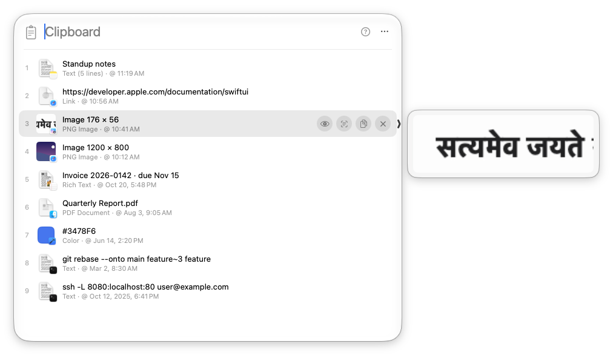
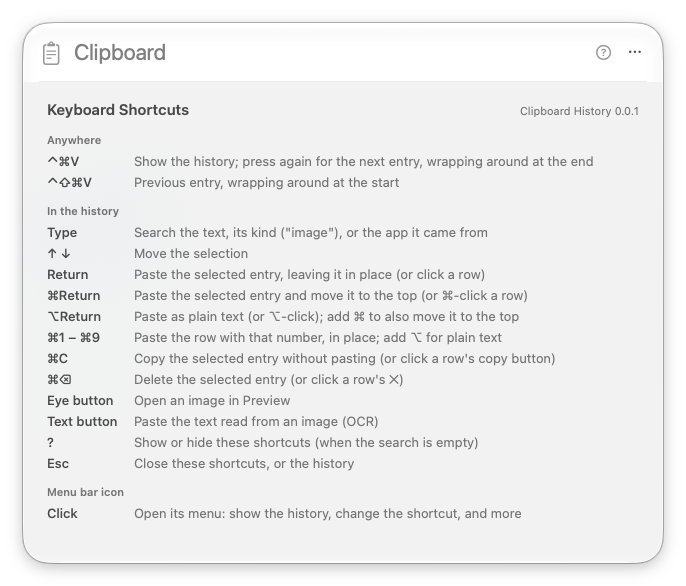

# Clipboard History

A tiny menu bar app that keeps a history of everything you copy on macOS. Press **⌃⌘V** to see it in a Spotlight-style panel, keep pressing ⌃⌘V to step through it, and press Return to paste the selected entry into the app you were in.

It does one thing well: get back something you copied and paste it, with one shortcut. There are no pinboards, snippets, sync or settings screens, and nothing to learn beyond a handful of keys (press **?** in the panel to see them all).





## How it differs from macOS's built-in clipboard history

macOS 26 Tahoe added a clipboard history to Spotlight. It's a fine start, and if it covers what you need you don't need this app. Here's where they differ:

| | Clipboard History | Built-in (Spotlight) |
| --- | --- | --- |
| Open it | **⌃⌘V**, one shortcut | ⌘Space, then ⌘4 |
| Pick an entry | Press ⌃⌘V again to step down, ⌃⇧⌘V to step up (wrapping around), Return to paste | Find it in the list, then double-click it or use its button |
| How long entries stay | The last 200 copies, until you delete them, across restarts | A rolling time window (as little as 30 minutes, at most days), then they're gone |
| Passwords | Copies that password managers mark as private are never recorded | Reportedly records everything copied, passwords included |
| Turned on | As soon as it's running | Off until you turn it on |

This app also pastes back every format a copy carried (plain and rich text, HTML, files, images, colors), lets you remove a single entry (✕ on its row, or ⌘⌫), and shows which app each copy came from.

Where the built-in history is the better choice:

- **Nothing to install.** It's part of macOS and Apple maintains it. This app isn't notarized by Apple, so the first launch needs a Gatekeeper override (see [Install](#install)).
- **Old entries expire.** The built-in history forgets copies after a while. This app keeps its 200 entries on disk until they're pushed out or you delete them, so anything sensitive you copied from an app that doesn't mark it private stays there too. Use ✕, ⌘⌫ or **Clear History** for anything you don't want kept.

## Showing and pasting

⌃⌘V is the default shortcut. You can change it, and reset it, from the menu bar icon's menu (see [Menu](#menu)); the rest of this README uses the default. You choose only the base shortcut, and adding ⇧ to it always steps up.

- **⌃⌘V** shows the history, with the newest entry selected. The panel floats over the app you were in, which stays frontmost and receives the paste, and opens on the screen that app's window is on (the pointer's screen if that can't be told).
- **⌃⌘V again** (while the panel is shown) selects the next entry. Past the last entry it wraps to the first, with the system alert sound if you turn on **Sound on Wrap** in the menu bar icon's menu (off by default).
- **⌃⇧⌘V** does the same in reverse, wrapping from the first entry to the last.
- **Return** pastes the selected entry into the app you were in, and the entry keeps its place in the history. Clicking an entry does the same.
- **⌘Return** pastes it and moves it to the top of the history. ⌘-clicking an entry does the same.
- **⌥Return** pastes rich text or a link as plain text, without its formatting. ⌥-clicking does the same, and ⌥⌘ combines both (plain text, moved to the top). Other entries paste as usual with ⌥.
- **⌘1 to ⌘9** paste the first nine rows directly, by the numbers beside them (⌥⌘1 to ⌥⌘9 as plain text). Plain digits still go into the search.
- The selected row, and the row under the pointer, show buttons at their right edge (the rest stay uncluttered): one copies the entry to the clipboard without pasting, and **✕** deletes it from the history. Rich text and link rows also have an **Aa** button, to the left of copy, that pastes them as plain text (⌘-click it to also move the entry to the top); image rows have an **eye** button that opens the image in Preview, and a **text** button (to the left of copy) that reads the text in the image and pastes it (see [Text in images](#text-in-images)).
- A **preview** beside the panel shows more of the selected entry, or of the row under the pointer: the text of a long or multi-line copy (scrollable; past its first 4,000 characters a last line says how many more there are, such as "… 6,210 more characters", and pasting still pastes them all), or a larger image that keeps its shape (300 points on its longer side). It appears once the selection or pointer settles, level with its row, and a small chevron at the panel's edge marks the row it belongs to.
- Each row shows what kind of data it holds (Text, Rich Text, Link, Image, a file type, Color), so you can step past entries that don't suit where you're pasting. Multi-line text also shows its line count, as in "Text (48 lines)", so it doesn't look like a one-line copy that starts the same way.

## Keys (while the panel is shown)

| Key | Action |
| --- | --- |
| Type | Search the history: the copied text (its first 4,000 characters), its kind ("image", "link", "rich text") or the app it came from ("chrome"). The panel opens with the search field focused |
| ↑ ↓ | Move the selection |
| ⌃⌘V / ⌃⇧⌘V | Next / previous entry, wrapping around (with a ding, if Sound on Wrap is on) |
| Return | Paste the selected entry, leaving it where it is in the history |
| ⌘Return | Paste the selected entry and move it to the top (or ⌘-click a row) |
| ⌥Return | Paste rich text or a link as plain text (or ⌥-click a row, or click its Aa button); ⌥⌘Return also moves it to the top |
| ⌘1 – ⌘9 | Paste the row with that number (the first nine rows are numbered); add ⌥ for plain text |
| ⌘C | Copy the selected entry to the clipboard without pasting |
| ⌘⌫ | Delete the selected entry from the history (or click a row's ✕) |
| Text button on an image row | Paste the text read from the image (OCR) |
| ? | Show or hide all the shortcuts (when the search is empty; or click the ? button) |
| Esc | Close the shortcuts if shown, otherwise the panel (clicking outside it closes it too) |

## Text in images

The **text** button on an image row reads the text in the image, on your Mac with macOS's own text recognition, and pastes it into the app you were in as plain text. It keeps the layout as far as it can: the indent, the blank lines between paragraphs, and the gaps between columns come back as spaces and empty lines, which matters for code, logs and tables. It's exact for the left edge and the blank lines, and close for the spacing inside a line: a table's columns line up to within about a character, and a run of several spaces inside one stretch of text that macOS doesn't split can come back as one.

It reads the languages macOS's own text recognition supports, picked automatically, including Hindi and Marathi (Devanagari), Chinese, Japanese, Korean, Arabic, Thai and Cyrillic scripts.

Small, dim line numbers beside code are the hardest thing for macOS to read: it finds some and misses others. When it finds a column of numbers, the app reads that column again at several sizes and keeps the reading most passes agree on. If the numbers read that way count steadily down the image, any it still missed between them (and beside text just above or below) are filled in, so those few numbers are inferred, not read. Nothing is filled in when the count isn't steady, such as with wrapped lines or two columns of numbers. Very pale numbers (light grey on white) can still lose some.

The first time you use it on an image, the panel stays open with a spinner on the button while the text is read. The text is then kept on disk beside the entry (in `~/Library/Application Support/ClipboardHistory/items`, removed with the entry), so every later paste of that image is immediate, even after a restart. An image with no text gives a beep, and its button dims.

The first read after the app starts can take a while (up to half a minute on some Macs) because macOS loads its recognition model. The app starts loading it in the background the first time you open the history with an image in it. If you close the panel before a read finishes, the read carries on and is kept, but nothing is pasted.

## What it keeps

- Every type of data a copy carried (plain text, rich text, HTML, links, files, images, colors), so a pasted entry is exactly what was copied.
- Image copies and copied image files show a thumbnail. Each row has a badge with the icon of the app it was copied from.
- Copies that apps mark as private (password managers and others that follow [nspasteboard.org](http://nspasteboard.org)) are never recorded.
- Up to 200 entries, newest first. Copying something in another app that's already in the history moves it to the top. Pasting or copying an entry from the history leaves it where it is, unless you paste it with ⌘Return or ⌘-click. To change the limit: `defaults write com.sandipchitale.clipboard-history maxItems -int 500`.
- Copies larger than 100 MB are skipped.
- The history is stored in `~/Library/Application Support/ClipboardHistory` and survives restarts.

## Menu

Click the menu bar icon to open its menu. The history itself is for the shortcut, though the menu has it too:

- **Show Clipboard History (⌃⌘V)**
- **Clear History…** (also in the panel's … menu), which asks for confirmation first
- **Change Shortcut…** (also in the panel's … menu), which opens a small dialog. Hold ⌃, ⌥ or ⌘ and press a key, and the box shows the shortcut (and what stepping up will be). Nothing changes until you click **Set** (or press Return). The ⌫ button (or the Delete key) clears the box, the ↺ button puts the default in it, and **Cancel** (or Esc) keeps the shortcut you have. Leave ⇧ out, since it's added to step up, and ⌘C, ⌘X and ⌘V aren't allowed, since every app uses them and Clipboard History pastes with ⌘V. If another app or macOS already uses the shortcut, it says so and keeps the current one
- **Reset Shortcut to ⌃⌘V**, to go back to the default (dimmed while you're already using it)
- **Sound on Wrap**, a ding when stepping past the last (or first) entry wraps around; off by default
- **Launch at Login**
- **Quit**

## Install

Clipboard History runs on macOS 26 or later, on Apple silicon and Intel Macs.

### Download (no developer tools needed)

1. Download `Clipboard-History-<version>.zip` from the [latest release](https://github.com/sandipchitale/clipboard-history/releases/latest), unzip it, and move **Clipboard History.app** to your Applications folder.
2. Clipboard History isn't notarized by Apple (notarization needs a paid Apple developer account, which this free project doesn't use), so macOS blocks it the first time. To allow it, run this once in Terminal:

   ```sh
   xattr -dr com.apple.quarantine "/Applications/Clipboard History.app"
   ```

   Or, without Terminal: try to open Clipboard History, then go to System Settings → Privacy & Security, scroll down, and click **Open Anyway**.
3. Open Clipboard History and grant **Accessibility** permission when asked (System Settings → Privacy & Security → Accessibility). Pasting needs it: the app pastes by sending ⌘V to the app you were in. Without it, choosing an entry still puts it on the clipboard.

Each release lists the zip's SHA-256 checksum, so you can check your download with `shasum -a 256 Clipboard-History-<version>.zip`.

### Build from source

If you have Apple's free command-line developer tools (`xcode-select --install`), you can build Clipboard History yourself. An app you build on your own Mac isn't blocked by Gatekeeper, so there's no step 2.

```sh
./install.sh           # builds, signs, copies to /Applications, launches
```

The first time you run it, `install.sh` creates a self-signed code-signing certificate called "Clipboard History Local Signing" in your login keychain. macOS asks for your password to trust it, and may ask once whether `codesign` can use the key (choose **Always Allow**). Every build is then signed with that certificate, so the Accessibility grant survives rebuilds. Then grant Accessibility as in step 3 above.

Builds are universal (Apple silicon and Intel).

`./build.sh` alone builds `build/Clipboard History.app` with an ad-hoc signature, and `./build.sh install` installs that. macOS treats each ad-hoc build as a new app, so you'd have to grant Accessibility again every time.

## Notes

- The shortcut and its ⇧ variant (⌃⌘V and ⌃⇧⌘V by default) are global shortcuts. If another app already uses one of them when you start Clipboard History, it can't register it (it logs a message saying so); pick another with **Change Shortcut…**.
- Accessibility permission is tied to the code signature. When it changes (for example, after an ad-hoc build), the install resets the old Accessibility entry and you grant it once more. To sign with your own certificate instead, set `CODESIGN_IDENTITY`.

## License

[MIT](LICENSE) © 2026 Sandip Chitale
